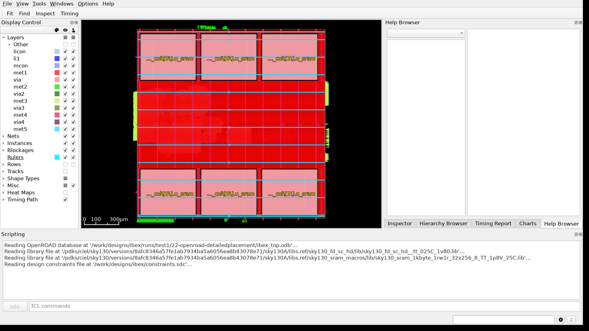

# Floorplan y placement con LibreLane (sky130)

Este proyecto es la **segunda parte** del trabajo práctico. Toma el netlist del
CPU [Ibex] que sintetizaste en la primera parte (repositorio `up-tp1`) y hace
la primera mitad de la implementación física con [LibreLane] y OpenROAD:

1. **Floorplan:** tamaño del chip (die y core), filas de celdas estándar,
   ubicación de las macros de SRAM, celdas de borde y de pozo (endcap y
   tap) y red de alimentación (PDN).
2. **Placement:** ubicación de los pines de entrada/salida y de las ~15.000
   celdas estándar, reparación eléctrica del diseño (buffers) y análisis de
   timing con los cables estimados a partir del placement.

**Acá no se sintetiza:** el netlist se importa del TP1. Las etapas que siguen
(síntesis del árbol de clock, routing y signoff) quedan para la parte 3.

[LibreLane]: https://github.com/librelane/librelane
[Ibex]: https://github.com/lowRISC/ibex

---

## 1. Instalación

### 1.1 Lo que ya tenés del TP1

Se usan **el mismo contenedor y el mismo PDK** que en el TP1, así que no hay
que instalar ni descargar nada nuevo: Docker, `ghcr.io/librelane/librelane:3.0.14`
y el PDK en `~/.ciel` ya están.

Clonar este repositorio **al lado** del del TP1:

```bash
cd <directorio donde está up-tp1>
git clone https://github.com/miguel9554/up-tp2.git
cd up-tp2
```

```
.
├── up-tp1/     el proyecto del TP1, con sus corridas en designs/ibex/runs/
└── up-tp2/     este proyecto
```

Si lo ubicás en otro lado, indicá dónde está el TP1 con `TP1=<ruta>` al
importar (sección 2).

### 1.2 La interfaz gráfica

Las herramientas corren dentro del contenedor, pero la GUI de OpenROAD se
muestra en tu pantalla a través de X11. En Ubuntu con escritorio (tanto con
Xorg como con Wayland) funciona sin configurar nada; solo verificá, **desde
una terminal del escritorio** (no por SSH):

```bash
echo $DISPLAY          # tiene que imprimir algo como :0 o :1
which xhost            # si no existe: sudo apt install x11-xserver-utils
```

`make gui` autoriza a tu usuario a abrir ventanas en el servidor X
(`xhost +SI:localuser:$USER`) y comparte el socket de X11 con el contenedor
(ver `run.sh`).

---

## 2. Importar el netlist del TP1

```bash
make import-tp1 TP1=../up-tp1
```

Esto busca en `../up-tp1/designs/ibex/runs/` la corrida `hd_*` más reciente
que haya llegado al STA (`make sta DESIGN=ibex` en el TP1) y copia a
`designs/ibex/tp1/`:

| Archivo              | Qué es                                                     |
| :------------------- | :--------------------------------------------------------- |
| `ibex_top.nl.v`      | netlist sintetizado: la entrada del floorplan               |
| `ibex_top.h.json`    | encabezado JSON del diseño (lo usa LibreLane para las macros) |
| `state.json`         | estado inicial de LibreLane: el netlist y las métricas del TP1 |
| `reports/`           | los reportes del TP1 (`qor.md`, `area.md`, `timing.md`, ...), para comparar |
| `SOURCE`             | nombre de la corrida del TP1 de la que salió                |

Para usar otra corrida: `make import-tp1 TP1=../up-tp1 FROM=hd_2026-10-01_17-17-44`.

La corrida tiene que tener la **configuración original** del TP1 (biblioteca
`hd`, período de 100 ns); si no, el import falla y lo avisa. Si borraste las
corridas del TP1, volvé a correr `make sta DESIGN=ibex` allá (es la única vez
que se sintetiza).

---

## 3. El flujo

### 3.1 Configuración

Todo está en `designs/ibex/`:

```
designs/ibex/
├── config.json           configuración de LibreLane (ver abajo)
├── constraints.sdc       restricciones de timing (las del TP1 + clock ideal)
├── macro_placement.cfg   ubicación de las macros de SRAM: la completás vos
├── tp1/                  lo importado del TP1 (sección 2)
└── runs/                 las corridas
```

Lo importante de `config.json`:

| Variable | Qué controla |
| :------- | :----------- |
| `FP_SIZING` | `relative`: el die se calcula a partir de la utilización; `absolute`: se fija con `DIE_AREA` |
| `FP_CORE_UTIL` | utilización buscada (área de instancias / área del core), en %, con `FP_SIZING = relative` |
| `FP_ASPECT_RATIO` | alto / ancho del core, con `FP_SIZING = relative` |
| `DIE_AREA` | `[x0, y0, x1, y1]` del die en µm, con `FP_SIZING = absolute` |
| `MACROS` | las vistas de la macro de SRAM (`.lef`, `.lib`, `.gds`) y sus 6 instancias |
| `MACRO_PLACEMENT_CFG` | el archivo con la ubicación de cada macro (`macro_placement.cfg`) |
| `PDN_MACRO_CONNECTIONS` | a qué nets de alimentación se conectan los pines de alimentación de las macros |
| `PL_TARGET_DENSITY_PCT` | (no está; se puede agregar) densidad objetivo del placement global, en % |
| `VERILOG_FILES` | LibreLane la exige, pero acá apunta al netlist importado y no se usa: no hay síntesis |
| `meta` | agrega un STA después del placement detallado (ver 3.2) |

Las variables que no aparecen toman el valor por defecto de LibreLane. La
lista completa, con su descripción, está en la documentación:
<https://librelane.readthedocs.io/en/latest/reference/step_config_vars.html>.

### 3.2 Correr

```bash
make floorplan        # solo el floorplan (segundos)
make place            # floorplan + placement + STA (~2-3 minutos)
```

Cada corrida crea un directorio nuevo en `designs/ibex/runs/`:
`fp_<fecha>_<hora>` para `make floorplan` y `pl_<fecha>_<hora>` para
`make place`. Para identificar experimentos agregá `NAME`:

```bash
make place NAME=centro     # runs/pl_centro_<fecha>_<hora>
```

Los dos arrancan del netlist importado y corren estos pasos (cada uno es un
subdirectorio numerado de la corrida):

| Paso | Directorio | Qué hace |
| ---: | :--------- | :------- |
| 1 | `01-openroad-floorplan` | crea el die, el core y las filas de sites |
| 5 | `05-odb-manualmacroplacement` | ubica las macros según `macro_placement.cfg` |
| 6 | `06-openroad-cutrows` | corta las filas donde hay macros |
| 7 | `07-openroad-tapendcapinsertion` | inserta celdas endcap (bordes de fila) y tap (contactos de pozo) |
| 9 | `09-openroad-generatepdn` | genera la red de alimentación (PDN) |
| 12 | `12-openroad-globalplacementskipio` | placement global preliminar, para saber dónde conviene cada pin |
| 13 | `13-openroad-ioplacement` | ubica los pines de entrada/salida en el borde del die |
| 16 | `16-openroad-globalplacement` | placement global: posición aproximada de cada celda |
| 19 | `19-openroad-stamidpnr` | STA después del placement global |
| 20 | `20-openroad-repairdesignpostgpl` | reparación: buffers y cambios de tamaño para max slew / max cap / fanout |
| 22 | `22-openroad-detailedplacement` | placement detallado (legalización): cada celda en un site de una fila, sin solapamientos |
| 23 | `23-openroad-stamidpnr-1` | STA final, con los cables estimados del placement |

`make floorplan` termina en el paso 10, después de la PDN. Si un paso falla,
el error está al final de la salida y en `<corrida>/<paso>/*.log`.

### 3.3 El SDC

`constraints.sdc` es el mismo del TP1 más una línea:

```tcl
unset_propagated_clock [all_clocks]
```

Todavía no hay árbol de clock: el clock gate maneja directamente los ~2350
flip-flops. Con el clock **propagado**, OpenSTA calcularía el retardo real de
ese net (decenas de ns) y daría resultados sin sentido; con el clock
**ideal**, el flanco llega a todos los flip-flops en el mismo instante, como
en el TP1. El árbol de clock se construye en la parte 3 (CTS).

---

## 4. Reportes

Cada corrida escribe en `<corrida>/reports/`:

| Archivo        | Contenido                                                          | Requiere |
| :------------- | :----------------------------------------------------------------- | :------- |
| `qor.md`       | Resumen: die, áreas, utilización, wirelength, timing contra el TP1 |          |
| `floorplan.md` | Die y core, filas y sites, ubicación de cada macro, celdas tap/endcap, PDN |  |
| `placement.md` | Instancias por clase, densidad y congestión del placement global, wirelength, buffers insertados por la reparación | `place` |
| `timing.md`    | Setup/hold y violaciones de max slew / max cap, TP1 contra placement, y caminos críticos | `place` |

Para comparar experimentos:

```bash
make compare                              # todas las corridas de placement
make compare RUNS="pl_a_... pl_b_..."     # solo esas
```

escribe `designs/ibex/runs/compare.md`, con una fila por corrida (die,
utilización, wirelength, congestión, buffers, slack, violaciones).

Algunas definiciones:

- **Utilización:** área de las instancias / área del core. `qor.md` da dos:
  contando todas las instancias (macros incluidas) y solo las celdas
  estándar sobre el área libre.
- **HPWL** (*half-perimeter wirelength*): para cada net, el semiperímetro del
  rectángulo que encierra todos sus pines; sumado sobre todos los nets. Es la
  estimación del largo de cables que optimiza el placement.
- **Congestión:** cuántos cables necesitaría cada región del chip contra
  cuántas pistas de ruteo tiene. Mayor a 1 significa que en alguna zona hay
  más demanda que recursos. El placer la reduce "inflando" celdas en las
  zonas congestionadas para separarlas.
- **Timing:** el STA después del placement se hace **solo en la esquina
  `tt`** (`nom_tt_025C_1v80`), con la resistencia y la capacidad de los cables
  estimadas a partir de la posición de las celdas. Para comparar con el TP1,
  usá la misma esquina.

---

## 5. La GUI de OpenROAD

```bash
make gui                         # última corrida, en su último estado
make gui RUN=pl_centro_...       # otra corrida
make gui RUN=pl_... STEP=09      # la corrida tal como quedó después del paso 9
```

`STEP` es el número de dos dígitos del paso (tabla de la sección 3.2). Si ese
paso no modifica el layout, se abre el último layout anterior. Por ejemplo:
`STEP=01` (die y filas), `STEP=05` (macros), `STEP=09` (PDN), `STEP=16`
(placement global), `STEP=22` (placement detallado).

La GUI abre el layout con las bibliotecas `.lib` y el SDC ya cargados, así que
también se puede analizar timing.



Lo básico:

| Qué | Cómo |
| :-- | :--- |
| Encuadrar todo el diseño | botón **Fit** de la barra de herramientas |
| Zoom | rueda del mouse |
| Medir distancias | `K` (regla): clic en el inicio y en el fin |
| Ver qué es algo | clic sobre el objeto: sus propiedades aparecen en la pestaña **Inspector** (nombre, celda, ubicación, orientación; en un net, su fanout) |
| Buscar una instancia o net | botón **Find** de la barra de herramientas |
| Mostrar / ocultar capas y objetos | panel **Display Control**: `Layers` (capas de metal), `Instances` (celdas estándar, macros, tap cells...), `Rows`, `Nets` |
| Mapas de calor | Display Control → **Heat Maps**: `Placement Density`, `Routing Congestion`, `Estimated Congestion (RUDY)`, `Pin Density`, ... |
| Caminos críticos | pestaña **Timing Report** → `Update`: lista los peores caminos; al seleccionar uno se dibuja sobre el layout |
| Módulos del RTL | pestaña **Hierarchy Browser**: muestra dónde quedaron las celdas de cada módulo (`if_stage`, `id_stage`, ...) |
| Guardar una imagen | en la consola Tcl de abajo: `save_image <archivo>.png` (queda en la raíz del proyecto) |

La consola Tcl (abajo) acepta cualquier comando de OpenROAD, por ejemplo
`report_checks -path_delay max` para el peor camino de setup.

**Lo que cambies en la GUI no se guarda en la corrida**: la GUI sirve para
mirar y medir. Para cambiar el floorplan hay que editar `config.json` o
`macro_placement.cfg` y volver a correr el flujo.

Para cerrar la GUI, cerrá la ventana (o `exit` en la consola Tcl).

---

## 6. Referencia

### Targets de make

| Comando                          | Qué hace                                              |
| :------------------------------- | :---------------------------------------------------- |
| `make import-tp1 TP1=<dir>`      | Importa el netlist del Ibex del TP1 (`FROM=<corrida>` opcional) |
| `make floorplan`                 | Floorplan: die, filas, macros, tap/endcap, PDN        |
| `make place`                     | Floorplan + placement + STA                           |
| `make gui`                       | Abre una corrida en la GUI de OpenROAD (`RUN=`, `STEP=`) |
| `make compare`                   | Compara las corridas de placement (`RUNS=` opcional)  |
| `make report`                    | Regenera los reportes de la última corrida            |
| `make shell`                     | Abre una terminal dentro del contenedor               |
| `make clean`                     | Borra todas las corridas                              |

`NAME=<nombre>` agrega un nombre al directorio de la corrida en `floorplan`
y `place`.

### Problemas frecuentes

| Problema                                          | Solución |
| :------------------------------------------------ | :------- |
| `the TP1 netlist was not imported yet`            | `make import-tp1 TP1=<directorio del TP1>` |
| `no hd run with STA`                              | En el TP1: `make sta DESIGN=ibex` |
| `[PDN-0235] Design has unplaced macros`           | Faltan macros en `macro_placement.cfg` (o están comentadas) |
| `Declared macros not instantiated in design`      | Hay un nombre de instancia mal escrito en `macro_placement.cfg` |
| `DISPLAY is not set`                              | Corré `make gui` desde una terminal del escritorio, no por SSH |
| `could not connect to display` / la GUI no abre   | `sudo apt install x11-xserver-utils` y volvé a correr `make gui` |
| Un paso falla                                     | Leé el final de `<corrida>/<paso>/*.log` |

### Más información

- Documentación de LibreLane: <https://librelane.readthedocs.io>
- Documentación de OpenROAD (comandos de cada herramienta, GUI):
  <https://openroad.readthedocs.io>
- Documentación del PDK sky130: <https://skywater-pdk.readthedocs.io>
